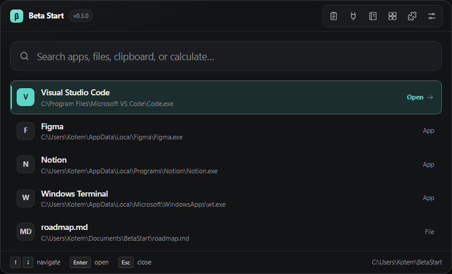
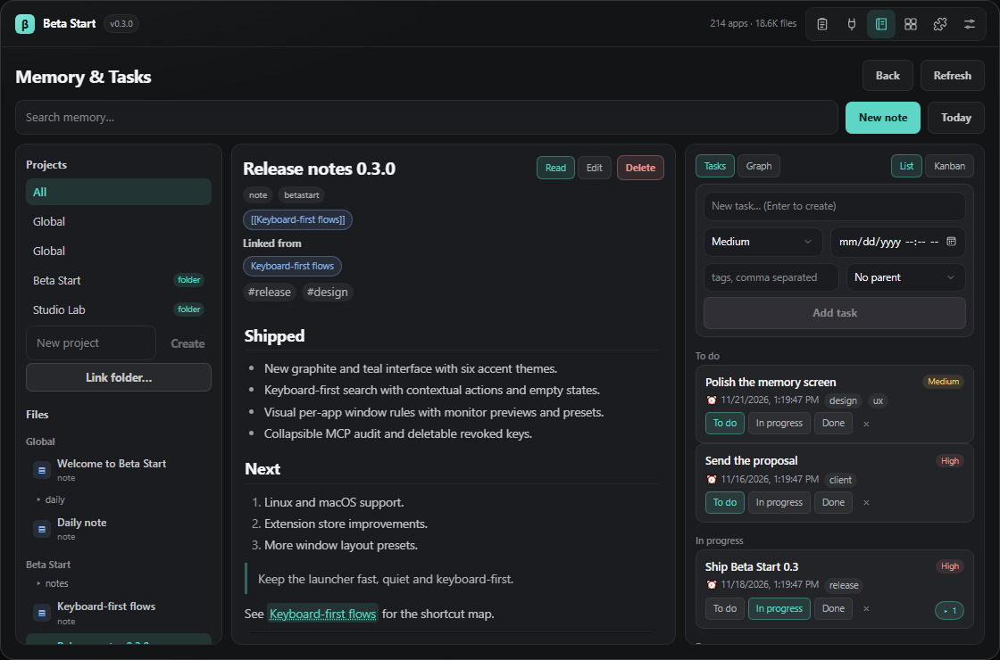
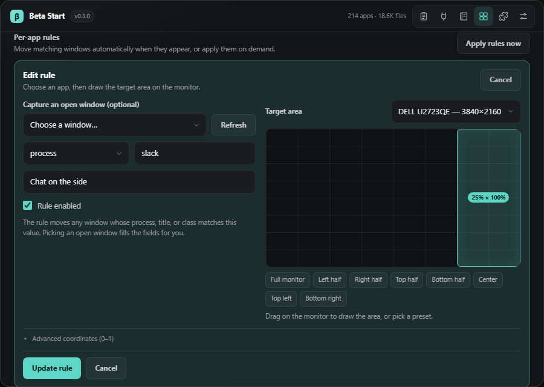

<p align="center">
  
</p>

<h1 align="center">Beta Start</h1>

<p align="center">
  <strong>One shortcut. Everything within reach.</strong><br />
  A free, open-source launcher and productivity hub for Windows — apps, files,
  clipboard, windows, notes, tasks and AI tools in one floating window.
</p>

<p align="center">
  <a href="https://github.com/Guilmeer/BetaStart/releases/latest">
    
  </a>
</p>

<p align="center">
  <a href="https://github.com/Guilmeer/BetaStart/releases/latest"></a>
  <a href="./LICENSE"></a>
  
  
</p>

<p align="center">
  <sub><a href="#what-it-does">Features</a> · <a href="#install">Install</a> · <a href="#mcp-ai-integration">MCP</a> · <a href="#build-from-source">Build from source</a> · <a href="#project-documents">Docs</a></sub>
</p>

<p align="center">
  
</p>

<p align="center">
  <sub>One search for apps, files, clipboard history, calculations and extension commands.</sub>
</p>

---

## What it does

| Do more in fewer keystrokes | Keep your data and workflow yours |
|:--|:--|
| **One search for everything**<br />Apps, files, clipboard history, calculations and extension commands in a single palette. Arrow keys and <kbd>Enter</kbd> are enough. | **Markdown memory**<br />Notes, projects and tasks are real files with YAML frontmatter. Open, edit and version them outside the app. |
| **Windows that stay organized**<br />Save layouts with a shortcut, then draw per-app regions on a monitor preview. Rules reapply automatically. | **AI-ready by design**<br />Expose memory, tasks, windows, search and clipboard through a token-efficient MCP server. |
| **Extend the launcher**<br />Install TypeScript/JavaScript extensions from a folder, Git or the store. Each run is isolated in its own Deno process. | **A native, quiet interface**<br />Dark, light or automatic; six accent colors; English and Portuguese; signed automatic updates. |

## Install

1. Download the latest installer from [Releases](https://github.com/Guilmeer/BetaStart/releases/latest).
2. Run `Beta.Start_x.y.z_x64-setup.exe` and follow the installer.
3. Open Beta Start with <kbd>Alt</kbd> + <kbd>Space</kbd>. It stays available in the system tray.

> [!IMPORTANT]
> Windows 10/11 and the Microsoft WebView2 Runtime are required. WebView2 is already present on most systems.

> [!NOTE]
> If Windows shows **"Windows protected your PC"**, choose **More info → Run anyway**. Updates are signed with minisign, but the installer does not have an Authenticode publisher certificate yet. See [`docs/CODE_SIGNING.md`](./docs/CODE_SIGNING.md).

Closing the window or clicking outside only hides it. Use **Quit** in the tray menu to exit completely.

## Getting started

| Action | Keys |
|:--|:--|
| Open or hide the launcher | <kbd>Alt</kbd> + <kbd>Space</kbd> |
| Move through results | <kbd>↑</kbd> <kbd>↓</kbd> |
| Open the selected result | <kbd>Enter</kbd> |
| Close the launcher | <kbd>Esc</kbd> |

Use the top bar to open **Clipboard**, **MCP**, **Memory & Tasks**, **Window manager**, **Extensions** and **Settings**.

Quick actions inside the search field:

| Type | To open |
|:--|:--|
| `g beta start` | Google |
| `yt lofi` | YouTube |
| `gh tauri` | GitHub |
| `w markdown` | Wikipedia |
| `ddg local-first` | DuckDuckGo |
| `maps coffee` | Google Maps |
| `12*8+3` | Calculator (copy the result with <kbd>Enter</kbd>) |

## Memory & Tasks

The second brain lives in plain Markdown. The main memory is in `global/`; each project lives in `projects/<slug>/`.



- Create **projects**, **notes** and **tasks**, with tags, priorities, due dates and reminders.
- Tasks support **subtasks**, status changes and **List** or **Kanban** views.
- Search across one project or everything; open a **daily note** in one click.
- `[[Note name]]` references create **backlinks** and appear in the **Linked from** panel.
- Edits autosave to real Markdown files, ready for Git or any external editor.

### Graph

Switch the right panel to **Graph** to explore the workspace as a force-directed graph.

| Edge | Meaning |
|:--|:--|
| **project** | project → note or task |
| **tag** | tag → item |
| **parent** | parent task → subtask |
| **link** | `[[Another note]]` reference |

Click a node to open its file. The project filter also filters the graph.

## Window manager

### Layouts

1. Arrange your windows manually.
2. Give the layout a name and click **Save current**.
3. Click the shortcut field and press the combination you want.
4. Use that shortcut to reapply the layout at any time.

Layouts remember exact pixel positions and scale proportionally when the monitor resolution changes.

### Per-app rules

Rules are visual: pick an open window or type a process, then draw the target area directly on the monitor preview. Presets cover the common cases — full monitor, halves, center and corners.



- Match by **process**, **title** or **class**.
- Choose the target monitor and draw the region, or use coordinate fields under **Advanced coordinates**.
- Enable, edit or disable each rule from the list.
- Rules apply automatically when a matching window appears, or on demand with **Apply rules now**.

Beta Start can also restore the last layout automatically when it starts.

## Clipboard

- Searchable history of copied **text and images**.
- **Pin** important items so they stay at the top.
- **Delete** individual items or clear everything that is not pinned.
- Copy a text or image item back to the clipboard.
- Preview images inside the app or open them in the default viewer.

## Extensions

An extension is a folder containing an `extension.json` manifest and TypeScript/JavaScript code.

- Install from a **local folder**, a **Git repository** or the **store**.
- Approve the permissions declared by the extension before running it.
- Extension commands appear directly in the launcher.
- Each run is isolated in its own Deno process.
- Logs for each run are available from **Extensions → Logs**.

Start with [`examples/hello-extension`](./examples/hello-extension); the store format is documented in [`examples/store/index.json`](./examples/store/index.json).

## MCP (AI integration)

Beta Start exposes its workspace to AI clients through the Model Context Protocol. Open **MCP** in the top bar to create a client, choose scopes and generate a token. The token is shown only once.

Supported clients include Claude Desktop, Cursor and any MCP-compatible tool.

### stdio

```json
{
  "mcpServers": {
    "betastart": {
      "command": "C:\\path\\to\\betastart.exe",
      "args": ["mcp", "--token", "bst_..."]
    }
  }
}
```

### HTTP/SSE

- **SSE:** `http://127.0.0.1:19000/sse?token=<token>`
- **JSON-RPC POST:** `http://127.0.0.1:19000/mcp`
- **Health:** `GET /health`

<details>
<summary><strong>Tool reference</strong></summary>

**Memory & projects**  
`memory.list`, `memory.read`, `memory.write`, `memory.search`, `memory.context`, `project.list`, `project.create`, `project.link`, `project.unlink`, `project.brief`

**Graph**  
`graph.query`, `graph.neighbors`, `graph.path`, `graph.explain`, plus `graph.get` for the full graph (expensive by design)

**Tasks**  
`tasks.list`, `tasks.create`, `tasks.create_many`, `tasks.update`, `tasks.delete`

**Windows**  
`windows.list`, `windows.move_resize`, `windows.apply_layout`, `windows.save_layout`

**Other**  
`extensions.list`, `extensions.run`, `search.query`, `clipboard.list`, `settings.get`, `settings.set`

MCP also exposes **resources** (notes and tasks as Markdown), ready-made **prompts**, a collapsible audit of recent calls, and a revoked-key section with permanent deletion.

</details>

### Token-efficient by default

> [!TIP]
> The server is designed to keep AI sessions cheap: compact JSON, relative paths, scoped subgraphs and byte-capped reads.

- `project.brief` summarizes a project in a few hundred tokens.
- `memory.read` supports `outline`, `range` and `full` modes, with a byte cap for `full`.
- `graph.query` and `graph.neighbors` return a scoped subgraph with a token budget instead of the whole graph.
- The server sends read/write **instructions** to the client on `initialize`.

### AI guidance

**MCP → AI guidance** writes or updates a marked block in the selected project's `AGENTS.md`, teaching the assistant to query Beta Start instead of re-reading files. Existing content is preserved.

## Settings and updates

| Area | What you can change |
|:--|:--|
| **Appearance** | Dark, light or automatic theme; teal, blue, violet, rose, amber or slate accent; English or Português (Brasil) |
| **Launcher** | Global shortcut, Windows key behavior, close-on-blur and start-with-Windows |
| **Search & index** | Include apps/files, indexed folders and maximum results |
| **Clipboard** | History limit |
| **Windows** | Automatic window rules and last-layout restoration |
| **MCP & extensions** | HTTP/SSE port, store URL and Deno path |
| **Updates** | Check, download and install signed updates |

### Automatic updates

1. Open **Settings → Updates**.
2. Click **Check for updates**.
3. If a new version is available, click **Download and install**.

Updates are signed with a minisign key and verified before installation. See [`docs/CODE_SIGNING.md`](./docs/CODE_SIGNING.md) for the Authenticode options and Windows SmartScreen details.

## Build from source

**Requirements:** Node.js 20+, Rust stable, the [Tauri prerequisites for Windows](https://v2.tauri.app/start/prerequisites/) and Microsoft WebView2. Deno is only needed to run extensions.

```powershell
git clone https://github.com/Guilmeer/BetaStart.git
cd BetaStart
npm install
npm run tauri dev
```

Build the installer:

```powershell
npm run tauri build
```

Run the checks used by CI:

```powershell
npm run build
cargo check --manifest-path src-tauri/Cargo.toml
cargo test --manifest-path src-tauri/Cargo.toml --lib
```

## Project documents

| Document | Contents |
|:--|:--|
| [`ARCH.md`](./ARCH.md) | Architecture, modules and technical decisions |
| [`docs/DESIGN.md`](./docs/DESIGN.md) | Visual language, tokens, UX rules and accessibility |
| [`CHANGELOG.md`](./CHANGELOG.md) | Release history |
| [`docs/CODE_SIGNING.md`](./docs/CODE_SIGNING.md) | SmartScreen, Authenticode and signing |
| [`docs/AUTO_UPDATE.md`](./docs/AUTO_UPDATE.md) | Updater and release flow |

## License

MIT — see [`LICENSE`](./LICENSE).

---

<p align="center">
  <sub>Beta Start is MIT-licensed. Built with Tauri, React, TypeScript and Rust.</sub><br />
  <sub><a href="https://github.com/Guilmeer/BetaStart/releases">Releases</a> · <a href="https://github.com/Guilmeer/BetaStart/issues">Issues</a> · <a href="./docs/DESIGN.md">Design notes</a></sub>
</p>
